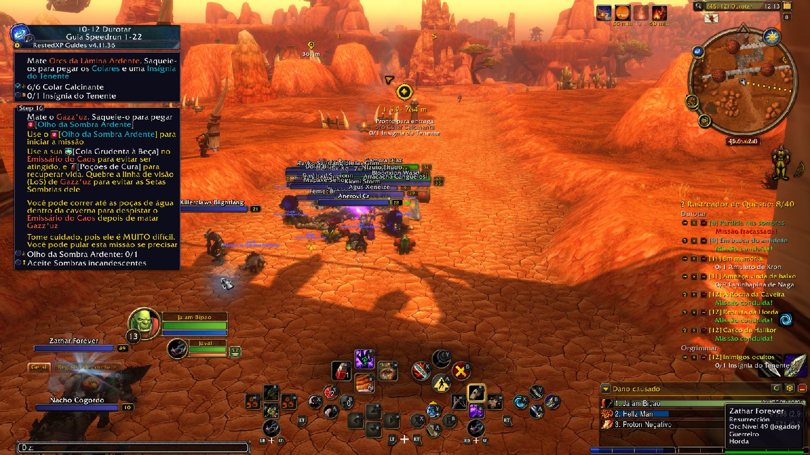

# CouchMaster Forever

**Uma interface de caçador pensada para jogar WoW Forever no controle.**

Botões fáceis de reconhecer, habilidades próximas da borda inferior e mais espaço para enxergar o mundo. Este projeto reúne o addon visual, o layout **hihi** e um guia em português para reproduzir a configuração com um controle de padrão Xbox, como o 8BitDo usado na montagem original.

> **Versão 2.1.5 · WoW Forever · Interface 16001 · Caçador · Português do Brasil**
>
> A imagem mostra a configuração original em jogo. Os painéis de missões, rotas e bolsas pertencem aos addons opcionais citados no guia; eles são instalados separadamente.

**[Baixar CouchMaster Forever 2.1.5 — addon, layout e guias](https://github.com/silvamarcello1-art/CouchMaster-Forever/raw/refs/heads/main/downloads/CouchMaster-Forever-v2.1.5.zip)**

## Comece por aqui

1. Baixe o projeto pelo botão **Code → Download ZIP** do GitHub, ou use o pacote disponibilizado pelo autor.
2. Com o jogo fechado, copie a pasta **`JoaoHunterUI`** para **`World of Warcraft/_forever_/Interface/AddOns/`**.
3. Ative **CouchMaster Forever** na lista de addons. O nome da pasta continua `JoaoHunterUI` para manter compatibilidade com a configuração original.
4. Habilite a interface nativa de controle do Forever. No **Modo de edição**, importe o texto de [profiles/hihi-layout.txt](profiles/hihi-layout.txt), salve o novo layout como **`hihi`** e selecione-o.
5. Crie os macros pelo menu `/macro` e coloque cada um no botão indicado em [Macros do caçador](docs/MACROS.md). O layout visual não transporta as habilidades das suas barras.
6. Digite `/cmf` para abrir as opções. Os mini-ícones secundários começam **desligados** em uma instalação nova.

O addon ativa os ajustes visuais em personagens **caçadores** com o layout chamado **hihi**, sem depender do nome do personagem. Leia a [instalação completa](docs/INSTALACAO.md) antes de substituir uma configuração que você já usa.

## O que muda na tela

| Elemento | Resultado |
|---|---|
| Letras X, Y, B e A | Permanecem visíveis nas habilidades, inclusive quando o grupo ativo é destacado. |
| Nomes dos macros sobre as habilidades | Ficam ocultos para dar lugar aos símbolos do controle. |
| Grupo central LT + RT | Recebe o ajuste vertical usado na configuração original. |
| Dois acessos do ajudante | Ganham retratos com as combinações LB + LT e RB + RT abaixo deles. |
| Indicadores laterais de seleção de alvos | A arte de ombro é ocultada; os comandos nativos continuam existindo. |
| Mini-ícones dos macros | Legendas fixas opcionais para os quatro ataques de RT. |

A posição dos quadros de vida, mana, alvo, medidor de dano e demais elementos nativos vem do **layout importado**. As janelas de Questie e RestedXP precisam ser ajustadas nas opções desses addons.

## Atalhos principais do perfil

| Controle | Macro | Uso |
|---|---|---|
| LT + X | HX Abrir | Enviar o pet, marcar o inimigo e iniciar o ataque; outro toque avança para a lentidão. |
| RT + X | HX Lento | Tiro de Concussão, pet e tiro automático. |
| RT + Y | HX Picada | Picada de Serpente, pet e tiro automático. |
| RT + B | HX Arcano | Tiro Arcano e tentativa de preparar Golpe do Raptor no mesmo botão. |
| RT + A | HX Corpo | Golpe do Raptor e ataque básico. |
| LT + → | HX Recuar | Parar o seu ataque, colocar o pet em passivo e fazê-lo seguir. |
| RT + ↑ | HX Chamar | Chamar ou tentar reviver o ajudante conforme a condição do pet. |

**Esses atalhos são a organização sugerida do perfil, não bindings instalados automaticamente.** Faça a atribuição na interface nativa e confirme os símbolos na sua tela. [Veja os controles e exercícios de familiarização](docs/CONTROLE.md).

## Guias

- [Instalação, importação do layout e primeiro teste](docs/INSTALACAO.md)
- [Controle, Bluetooth, Steam Input e leitura das barras](docs/CONTROLE.md)
- [Personalizar tamanho, posição, botões e aparência](docs/PERSONALIZACAO.md)
- [Todos os macros: código, funcionamento e limites](docs/MACROS.md)
- [Addons recomendados e configuração de uma tela organizada](docs/ADDONS.md)
- [Problemas frequentes, atualização e restauração](docs/SOLUCAO-DE-PROBLEMAS.md)
- [Histórico da versão e verificações](CHANGELOG.md)

## Como o recurso visual funciona

`/cmf ligar` mostra pequenas imagens das ações secundárias reconhecidas nos macros `HX Lento`, `HX Picada`, `HX Arcano` e `HX Corpo`. `/cmf desligar` oculta essas imagens. `/jhui` continua funcionando como atalho alternativo.

As legendas descrevem o conteúdo fixo desses macros. Elas não escolhem a próxima habilidade, não verificam recarga, alcance ou mana e não alternam o ícone principal. A recarga e a indicação de uso do botão continuam sob responsabilidade da interface nativa. Um macro com várias ações pode não mostrar a situação individual de todas elas no ícone principal.

## Compatibilidade e escopo

O visual original foi usado em jogo com caçador de nível baixo e controle 8BitDo via Bluetooth. A edição de distribuição remove o vínculo ao personagem original, mantém o comportamento visual e acrescenta `/cmf`.

O projeto depende dos quadros nativos de controle do **Forever**. Não há suporte verificado para Retail, outras variantes de Classic, outras classes ou interfaces que substituam essas barras. A versão de distribuição passou por análise de sintaxe e testes isolados; a reprodução completa em uma segunda conta continua sendo uma etapa de validação.

## Conteúdo e créditos

Este download contém nosso addon, o layout exportado e a documentação. Os outros addons são indicados por **links dos próprios autores** em [ADDONS.md](docs/ADDONS.md). Não há arquivos de conta, senhas, banco de personagens, configurações completas de WTF, guias pagos ou pacotes de voz incluídos.

Código próprio e documentação sob [licença MIT](LICENSE). Interface, símbolos e imagens do jogo pertencem aos respectivos titulares; os símbolos são reutilizados diretamente do cliente instalado, sem um pacote de texturas separado. Os addons citados mantêm suas próprias licenças.
